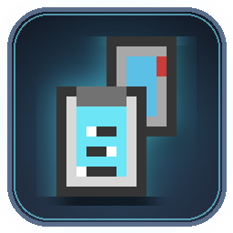

# DimStorage Configurator

An unofficial addon for [DimStorage](https://www.curseforge.com/minecraft/mc-mods/dimstorage) on **Minecraft 1.21.1 / NeoForge**.

This mod adds the **Dimensional Configurator**, an item that copies the settings of a DimChest or DimTank and applies them to another one.

> This project is not affiliated with Edivad99. DimStorage and EdivadLib are separate projects and are not bundled with this mod.

## Features

- Copy the frequency, owner, locked state, and DimTank auto-eject setting of a DimStorage block.
- Apply the copied settings to any number of DimChests / DimTanks.
- Enchantment glint shows that a configuration is stored.
- Safe clearing: the configuration is not cleared while aiming at a DimStorage block.
- JEI-friendly crafting recipe and creative tab integration.

## Requirements

| Dependency | Version |
| --- | --- |
| Minecraft | 1.21.1 |
| NeoForge | 21.1+ |
| DimStorage | 9.0.0+ |
| EdivadLib | 3.0.0+ |

## Installation

1. Install NeoForge 21.1 or newer for Minecraft 1.21.1.
2. Place DimStorage, EdivadLib, and `DimStorageConfigurator-1.21.1-<version>.jar` in the `mods` folder.
3. Launch the game.

## Usage

| Action | Result |
| --- | --- |
| Right-click a DimChest / DimTank | Copy its configuration. The item starts glowing. |
| Shift + right-click a DimChest / DimTank | Apply the stored configuration. |
| Shift + right-click the air | Clear the stored configuration (the glint disappears). |

The configuration is not cleared when the block you are aiming at is a DimChest or DimTank, even if it is just out of interaction range.

### Item ID

```
dimstorageconfigurator:dimensional_configurator
```

### Recipe

```
  I
R D R
  I
```

- `I` = Iron Ingot
- `R` = Redstone
- `D` = Dimensional Core

## Supported Languages

- English (US) — `en_us`
- Japanese — `ja_jp`
- Simplified Chinese — `zh_cn`
- Traditional Chinese — `zh_tw`
- Korean — `ko_kr`
- French — `fr_fr`
- German — `de_de`
- Spanish — `es_es`
- Italian — `it_it`
- Brazilian Portuguese — `pt_br`
- Russian — `ru_ru`
- Turkish — `tr_tr`
- Polish — `pl_pl`
- Ukrainian — `uk_ua`
- Dutch — `nl_nl`

Translations live in `src/main/resources/assets/dimstorageconfigurator/lang/`.

## Building

Requirements: JDK 21.

```bash
./gradlew build
```

The mod jar is generated in `build/libs/`.

## License

This project is licensed under the **MIT License**. See [LICENSE](LICENSE).

DimStorage and EdivadLib are separate projects by Edivad99 and are licensed under their own terms.
